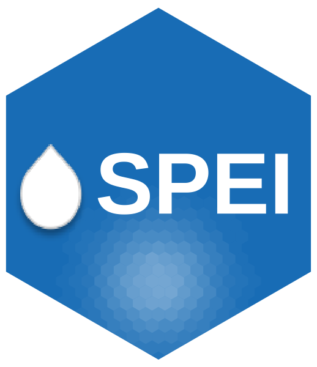

#  [](https://cran.r-project.org/package=SPEI)

[](https://github.com/sbegueria/SPEI/actions/workflows/R-CMD-check.yaml)
[](https://app.codecov.io/gh/sbegueria/SPEI)
[](https://cran.r-project.org/package=SPEI)
[](https://cran.r-project.org/web/checks/check_results_SPEI.html)
[](https://cran.r-project.org/package=SPEI)
[](https://github.com/sbegueria/SPEI/commits/master)
[](https://www.gnu.org/licenses/old-licenses/gpl-2.0.html)
[](https://github.com/sbegueria/SPEI/issues)
[](https://github.com/sbegueria/SPEI/stargazers)

SPEI is an R package incorporating a set of functions for computing potential or reference evapotranspiration and several widely used drought indices,  including the **Standardized Precipitation-Evapotranspiration Index (SPEI)** and the **Standardized Precipitation Index (SPI)**.

The package is centered on the SPEI. For more information on this drought index, please visit 
[https://spei.csic.es](https://spei.csic.es/).


## Details

Functions `<spei>` and `<spi>` are the workhorse of the SPEI library. Other functions such as `<kern>` and `<parglo.maxlik>` are auxiliary low-level functions that will not be used directly by the typical user. Functions for computing potential evapotranspiration are provided, too, for helping computing the SPEI. These are: `<thornthwaite>`, `<hargreaves>` and `<penman>`.


## Installation

Install the latest stable version from GitHub:

```r
library(devtools)
install_github('sbegueria/SPEI')
```

Or get the latest version on [CRAN](https://cran.r-project.org):

```r
install.packages('SPEI')
```

Please, note that the CRAN version may not be the very latest version of the package.

If you are interested in testing the current development version you can do so by installing the `devel` branch:

```r
library(devtools)
install_github('sbegueria/SPEI@devel')
```


## References

To cite package ‘SPEI’ in publications use:

* Beguería S, Vicente-Serrano SM (2026). _SPEI: Calculation of the Standardized Precipitation-Evapotranspiration Index_. R package version 1.9.0, https://spei.csic.es, https://github.com/sbegueria/SPEI.

A BibTeX entry for LaTeX users is:

```bibtex
@Manual{SPEI,
    title = {SPEI: Calculation of the Standardized Precipitation-Evapotranspiration Index},
    author = {Santiago Beguería and Sergio M. Vicente-Serrano},
    year = {2026},
    note = {R package version 1.9.0},
    url = {https://spei.csic.es, https://github.com/sbegueria/SPEI},
}
```

If you use the SPEI index, consider citing these references:

* S.M. Vicente-Serrano, S. Beguería, J.I. López-Moreno. 2010. A Multi-scalar drought index sensitive to global warming: The Standardized Precipitation Evapotranspiration Index – SPEI. *Journal of Climate* **23**: 1696, DOI: 10.1175/2009JCLI2909.1.

* Beguería S, Vicente-Serrano SM, Reig F, Latorre B. 2014. Standardized precipitation evapotranspiration index (SPEI) revisited: parameter fitting, evapotranspiration models, tools, datasets and drought monitoring. *International Journal of Climatology* **34(10)**: 3001-3023.

Other (possibly useful) references:

* Vicente-Serrano, S.M., Beguería, S., López-Moreno, J.I., Angulo, M., El Kenawy, A. 2010. A new global 0.5° gridded dataset (1901-2006) of a multi-scalar drought index: comparison with current drought index datasets based on the Palmer Drought Severity Index. *Journal of Hydrometeorology* **11**: 1033--1043.

* Beguería, S., Vicente-Serrano, S.M. y Angulo, M. 2010. A multi-scalar global drought data set: the SPEIbase: A new gridded product for the analysis of drought variability and impacts. *Bulletin of the American Meteorological Society* **91**: 1351--1354.

* Vicente-Serrano, S.M., Beguería, S. and Juan I. López-Moreno. 2011. Comment on “Characteristics and trends in various forms of the Palmer Drought Severity Index (PDSI) during 1900-2008” by A. Dai. *Journal of Geophysical Research-Atmosphere* **116**: D19112, doi:10.1029/2011JD016410.

* Vicente-Serrano, S.M., Santiago Beguería, Jorge Lorenzo-Lacruz, Jesús Julio Camarero, Juan I. López-Moreno, Cesar Azorín-Molina, Jesús Revuelto, Enrique Morán-Tejeda and Arturo Sánchez-Lorenzo. 2012. Performance of drought indices for ecological, agricultural and hydrological applications. *Earth Interactions* **16**: 1--27.

* Vicente-Serrano, S.M., Célia Gouveia, Jesús Julio Camarero, Santiago Beguería, Ricardo Trigo, Juan I. López-Moreno, César Azorín-Molina, Edmond Pasho, Jorge Lorenzo-Lacruz, Jesús Revuelto, Enrique Morán-Tejeda and Arturo Sanchez-Lorenzo. 2012. The response of vegetation to drought time-scales across global land biomes. *Proceedings of the National Academy of Sciences of the United States of America*, doi: 10.1073/pnas.1207068110.

* Vicente-Serrano, S.M., Gerard Van der Schrier, Santiago Beguería, Cesar Azorín-Molina, Juan-I. Lopez-Moreno. 2015. Contribution of precipitation and reference evapotranspiration to drought indices under different climates. *Journal of Hydrology* **526**: 42--54.

* Vicente-Serrano, S.M., Beguería, S. 2016. Comment on "Candidate Distributions for Climatological Drought Indices (SPI and SPEI)" by James H. Stagge et al. *International Journal of Climatology* **36**: 2120--213.


## Version history

The full list of changes is in [NEWS.md](NEWS.md), and can also be shown from R with `SPEINews()`.

Version 1.9.0 fixes a number of bugs found in a full audit of the package. Some of them change the results with respect to version 1.8.1; see the section *Changes in results* in [NEWS.md](NEWS.md) for which options are affected and by how much.


## Any problems?

Feel free to [send an issue](https://github.com/sbegueria/SPEI/issues) if you have any questions or problems.


## Copyright and license

Copyright (C) 2013–2026 Santiago Beguería and Sergio M. Vicente-Serrano.

This program is free software: you can redistribute it and/or modify it under the terms of the GNU General Public License as published by the Free Software Foundation, either version 2 of the License, or (at your option) any later version.
